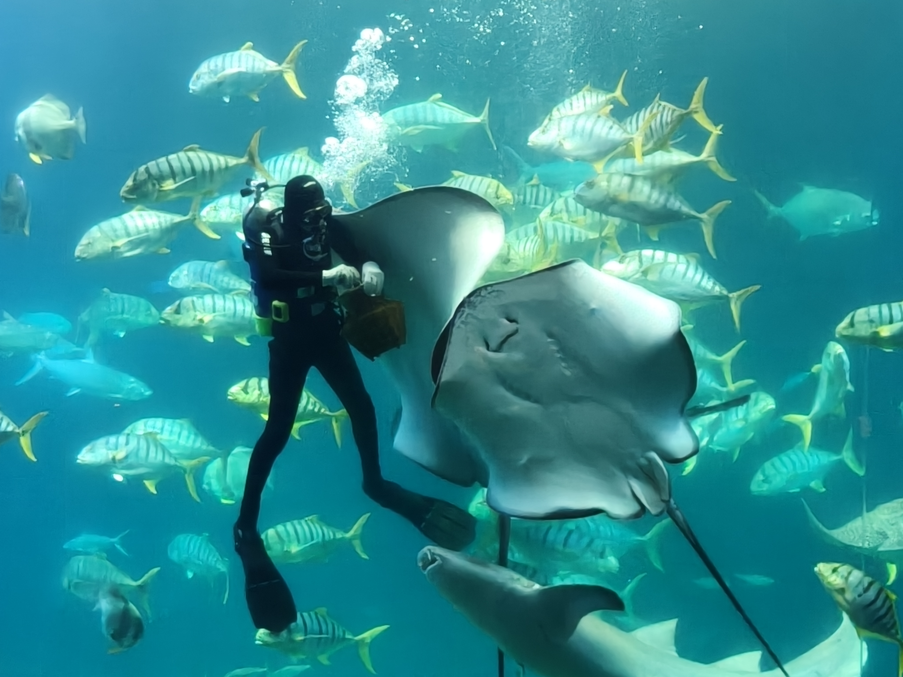

# 林映辰的個人網頁[cite: 1]

## 1. 基本資料[cite: 1]

| 項目 | 內容 |
| :--- | :--- |
| **姓名 / Name** | 林映辰[cite: 1] |
| **系級 / Department & Year** | 生命科學暨生物科技學系一年級[cite: 1] |
| **學校 / University** | 臺灣海洋大學[cite: 1] |
| **家鄉 / Hometown** | 台中[cite: 1] |
| **Email** | student@example.com[cite: 1] |
| **GitHub** | [your-account](https://github.com/your-account)[cite: 1] |

📷 個人照片：

---

## 2. 關於我 About Me[cite: 1]
*(請改寫成自己的內容，建議 80–150 字。)*[cite: 1]

---

## 3. 我的興趣 Interests[cite: 1]
* 🏀 **運動：** 
* 🎵 **音樂：** 
* 🎮 **休閒：** 
* 💻 **學習：** 

---

## 4. 我的學習與技能 Skills[cite: 1]

| 技能 | 目前程度 | 我會做什麼 |
| :--- | :--- | :--- |
| **Python** | 初學[cite: 1] | 變數、if、for、function[cite: 1] |
| **GitHub** | 初學[cite: 1] | 建立 repository、commit、push[cite: 1] |
| **英文** | 中等[cite: 1] | 閱讀英文教材[cite: 1] |

---

## 5. 我做過的小作品 Projects[cite: 1]

### Project 1 ｜ 我的第一個 Python 程式[cite: 1]
這是我在課堂中完成的第一個 Python 小作品。我學會如何使用變數、輸入資料，以及將結果顯示在畫面上。[cite: 1]
* **GitHub 連結：** [your-project](https://github.com/your-account/your-project)[cite: 1]

### Project 2 ｜ （自行填寫）[cite: 1]
* **作品內容：** __________________________________________________[cite: 1]
* **GitHub 連結：** ________________________________________________[cite: 1]

---

## 6. 我的學習目標 Goals[cite: 1]
* 學會 Python 基礎程式設計。[cite: 1]
* 學會使用 Git 與 GitHub 管理自己的作品。[cite: 1]
* 建立自己的第一個個人網站。[cite: 1]
* 未來能將程式設計應用在自己的專業領域。[cite: 1]

---

## 7. 聯絡我 Contact[cite: 1]
* **Email：** student@example.com[cite: 1]
* **GitHub：** [your-account](https://github.com/your-account)[cite: 1]
* **其他公開連結（選填）：** LinkedIn / 個人作品集 / 社群網站[cite: 1]

---

## 8. 給未來的自己 A Note to My Future Self[cite: 1]
希望一年後回來看這個網頁時，我已經學會更多程式設計技巧，也完成更多自己的作品。[cite: 1]
